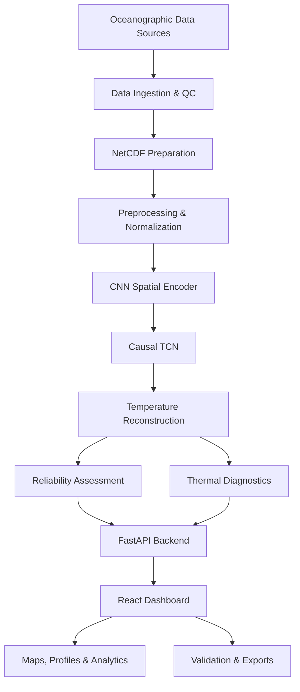

# 🌊 OceanEmbed-NIO
### Team DeepSindhu | AI-Powered Subsurface Ocean Intelligence

<p align="center">

**Reconstructing the Ocean Beneath the Surface.**

An AI-driven research platform for retrospective subsurface ocean temperature reconstruction, thermal diagnostics, oceanographic visualization, and cyclone-related ocean heat analysis.

</p>

---

## 1. Overview

**OceanEmbed-NIO** is a research-oriented ocean intelligence platform designed to investigate subsurface ocean temperature structures using surface oceanographic observations and deep learning.

The project explores how satellite-derived surface parameters can be combined with spatiotemporal machine learning architectures to estimate temperature distributions beneath the ocean surface.

It integrates a Python-based scientific computing and inference pipeline with a React-based interactive dashboard, enabling researchers to explore temperature fields, inspect depth profiles, examine thermal characteristics, and evaluate reconstruction reliability.

The platform is developed under **Team DeepSindhu**, with an emphasis on scientific transparency, reproducibility, and responsible AI-driven oceanographic analysis.

## 2. Key Capabilities

| Module | Description |
|---|---|
| Ocean Exploration | Interactive visualization of ocean temperature fields across geographical regions and depths. |
| Subsurface Reconstruction | CNN + causal TCN architecture for estimating temperature profiles at multiple depths. |
| Thermal Diagnostics | Analysis of Tropical Cyclone Heat Potential (TCHP), Depth of 26°C Isotherm (D26), and thermal mixed-layer depth (MLD-T). |
| Model Validation | Evaluation framework incorporating observational matchups and baseline comparisons. |
| Reliability Assessment | Supported, Caution, and Abstain classifications to communicate prediction reliability. |
| Disaster Readiness | Retrospective ocean thermal context and cyclone-related awareness information. |
| Data Visualization | Interactive maps, temperature cross-sections, depth profiles, charts, and scientific diagnostics. |
| Data Export | Export capabilities for downstream analysis and research workflows. |

## 3. System Architecture

OceanEmbed-NIO follows a modular architecture connecting oceanographic data preparation, deep learning, scientific diagnostics, backend services, and interactive visualization.



### Technology Stack

| Layer | Technologies |
|---|---|
| Frontend | React 19, TypeScript, Vite |
| Visualization | Plotly.js, D3 |
| Backend | Python, FastAPI, Uvicorn |
| Deep Learning | PyTorch |
| Scientific Computing | NumPy, SciPy, Xarray |
| Oceanographic Processing | GSW, NetCDF, HDF5 |
| Data Configuration | YAML, Pydantic |
| Testing | Pytest, Node.js test runner |
| Development | VS Code, Git, GitHub |

## 4. Deep Learning Methodology

The core reconstruction architecture combines spatial feature extraction with temporal sequence modelling.

**CNN — Spatial Feature Extraction**

Extracts spatial patterns and relationships from oceanographic surface variables.

**Causal TCN — Temporal Modelling**

Uses causal temporal convolutions to capture historical dependencies while preventing future-frame leakage within the model's temporal receptive field.

**Direct Residual Prediction**

The decoder combines the latest encoded representation, prior temperature estimates, and static geographical features to predict temperature residuals across multiple depths.

The architecture is designed to reconstruct temperature at 15 target depth levels:

`0, 5, 10, 20, 30, 50, 75, 100, 125, 150, 200, 300, 500, 700, 1000 m`

### Model Evaluation

The research framework incorporates:

- Climatology baseline.
- Ridge regression baseline.
- Persistence baseline.
- Argo observational matching.
- Training, validation, calibration, and test separation.
- Per-depth evaluation and reliability assessment.

Model selection is separated from final test evaluation to reduce evaluation leakage.

## 5. Oceanographic Diagnostics

OceanEmbed-NIO incorporates multiple oceanographic indicators for investigating subsurface thermal conditions.

| Indicator | Purpose |
|---|---|
| TCHP | Estimates the integrated heat content of the upper ocean relevant to tropical cyclone research. |
| D26 | Identifies the depth of the 26°C isotherm. |
| MLD-T | Estimates thermal mixed-layer depth using a temperature-threshold criterion. |
| Temperature Anomaly | Examines deviations from a specified temperature reference. |
| Thermal Profiles | Enables depth-wise examination of subsurface temperature distributions. |

These indicators provide retrospective scientific context and are not intended to function as standalone cyclone intensity forecasts.

## 6. Reliability & Scientific Transparency

A central design principle of OceanEmbed-NIO is that the system should not present every estimated value as equally reliable.

The reliability framework classifies grid-cell estimates into three states:

- **Supported:** Available inputs satisfy the configured support criteria.
- **Caution:** The estimate has one or more declared reliability limitations.
- **Abstain:** Insufficient support exists to present an estimate.

The system also incorporates source provenance, data-quality checks, missing-data handling, depth-support constraints, and evaluation boundaries.

This approach prioritizes transparent scientific interpretation over artificially complete visualizations.

## 7. Interactive Dashboard

The React dashboard provides a multi-view interface for exploring oceanographic information.

Its six major navigation areas include:

1. **Explore** — Geographical temperature fields, depth selection, thermal diagnostics, and point-based profiles.
2. **Validate** — Model evaluation, observational comparisons, and baseline analysis.
3. **Heat Events** — Retrospective marine heat-event and thermal analysis.
4. **Cyclone Context** — Historical cyclone-track and ocean thermal context.
5. **Scientific Analysis** — Depth-oriented scientific exploration and supporting visualizations.
6. **Disaster Readiness** — Regional ocean heat potential, thermal indicators, reliability summaries, and public-awareness information.

The interface uses a dark navy-and-cyan visual identity, interactive geographical layers, scientific cross-sections, and data-driven visual components.

## 8. Installation & Execution

### Prerequisites

- Python 3.11 or newer.
- Node.js 22.
- npm.
- Git (recommended).

### Clone the repository

```bash
git clone https://github.com/YOUR-USERNAME/OceanEmbed-NIO.git

cd OceanEmbed-NIO
```

Replace the repository URL with the actual GitHub repository URL.

### First-time setup

The project includes a unified launcher that configures the Python environment, installs the backend dependencies, and installs the locked frontend dependencies.

```bash
python start.py --setup
```

### Launch the application

```bash
python start.py
```

Open the dashboard:

**http://127.0.0.1:5173**

The API is available at:

**http://127.0.0.1:8000**

API documentation:

**http://127.0.0.1:8000/docs**

The launcher starts the backend and frontend together. Press `Ctrl + C` to stop both services.

### Important

The default launcher creates a geographic synthetic demonstration dataset if no existing `OCEAN_RUN` is configured. This allows the interface and application workflow to be explored without first downloading real oceanographic datasets.

## 9. Testing & Verification

Backend tests:

```bash
.venv/bin/python -m pytest
```

Windows:

```powershell
.venv\Scripts\python.exe -m pytest
```

Frontend tests:

```bash
cd frontend
npm test
```

Frontend production build:

```bash
npm run build
```

Return to the project root after completing frontend checks.

For release-level verification and implementation status, consult:

- `docs/RELEASE_STATUS.md`
- `docs/VERIFICATION.json`
- `docs/STOPS.md`

## 10. Research Data & Scientific Limitations

**Important: OceanEmbed-NIO is a buildable research prototype, not a scientifically validated operational oceanographic product.**

The included synthetic demonstration data are intended for software testing, visualization, and engineering verification. They do not establish real-world ocean reconstruction accuracy.

The repository does not provide a completed real-data-trained model, bundled real satellite observations, or bundled Argo observational datasets.

Before conducting scientific evaluation:

1. Acquire the relevant oceanographic datasets.
2. Review actual source variables, coordinate systems, units, and quality-control conventions.
3. Verify NetCDF source mappings.
4. Prepare and inspect the regional dataset.
5. Train the model using the prescribed data partitions.
6. Evaluate against appropriately separated observational measurements.
7. Report performance, uncertainty, and limitations independently.

Additional limitations, assumptions, and implementation status are documented in `docs/ARCHITECTURE.md` and `docs/RELEASE_STATUS.md`.

## 11. Repository Structure

```text
OceanEmbed-NIO/
│
├── frontend/
│   ├── public/
│   ├── src/
│   ├── tests/
│   ├── package.json
│   └── vite.config.ts
│
├── src/
│   └── oceanembed/
│       ├── api.py
│       ├── model.py
│       ├── training.py
│       ├── inference.py
│       ├── dataset.py
│       ├── prepare.py
│       ├── observations.py
│       ├── reliability.py
│       ├── science.py
│       ├── cyclone.py
│       ├── rama.py
│       └── baseline.py
│
├── configs/
│   ├── regional.yaml
│   ├── sources.example.yaml
│   └── rama.example.yaml
│
├── data/
│   └── observations/
│
├── demo/
│   └── runs/
│
├── notebooks/
│   └── 03_train_colab.ipynb
│
├── scripts/
│   ├── check_core.py
│   ├── verify_release.py
│   └── verify_demo_artifacts.py
│
├── tests/
│
├── docs/
│   ├── ARCHITECTURE.md
│   ├── DATA_CONTRACT.md
│   ├── RELEASE_STATUS.md
│   ├── SOURCES.md
│   └── STOPS.md
│
├── start.py
├── pyproject.toml
├── README.md
└── START_HERE.md
```

## 12. Documentation

For further technical details and implementation guidance:

| Document | Purpose |
|---|---|
| `START_HERE.md` | Initial setup and guided execution |
| `ARCHITECTURE.md` | System architecture |
| `BATCHES.md` | Implementation batches |
| `docs/ARCHITECTURE.md` | Scientific methodology and limitations |
| `docs/DATA_CONTRACT.md` | Dataset specifications |
| `docs/SOURCES.md` | Data and software references |
| `docs/STOPS.md` | Guided research execution |
| `docs/RELEASE_STATUS.md` | Implementation and verification status |
| `notebooks/03_train_colab.ipynb` | Google Colab training workflow |

## 13. Project Vision

OceanEmbed-NIO aims to explore how artificial intelligence can support deeper understanding of ocean thermal structures through the integration of satellite-derived observations, scientific computing, and spatiotemporal deep learning.

By combining subsurface reconstruction, ocean heat diagnostics, reliability-aware visualization, and retrospective cyclone analysis, the project establishes a foundation for further research into regional ocean intelligence.

**The objective is not simply to visualize the ocean surface, but to investigate the thermal structures hidden beneath it.**

---

<p align="center">

**OCEANEMBED-NIO**

*Team DeepSindhu*

**Exploring Beneath the Surface. Engineering Ocean Intelligence.**

</p>

---

*Research prototype | AI/ML | Oceanographic Computing | Subsurface Temperature Reconstruction*
